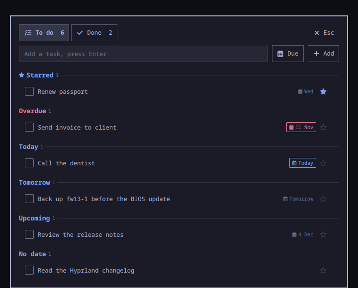
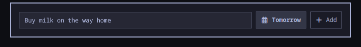
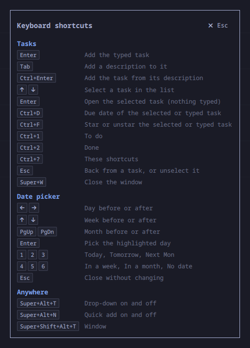
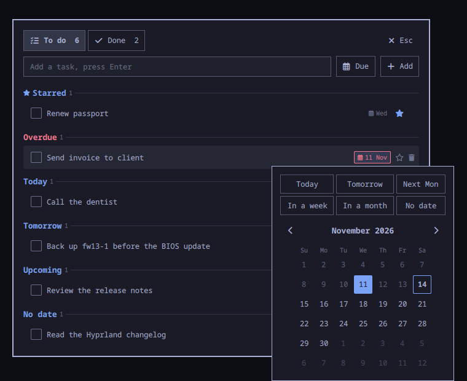

# To Do

A to-do list for [Omarchy](https://omarchy.org/): a drop-down panel, a quick
add field, and an app window over one list, with due dates and starred tasks. No account and no
sync: tasks stay in one file on this computer. Errors are reported to Sentry,
without task text (see [Error reports](#error-reports)).



## Install

Tested with Omarchy 4.5.0:

```bash
omarchy plugin add https://github.com/simonmcschubert/omarchy-todo.git --enable
~/.config/omarchy/plugins/simonmcschubert.todo/setup
```

`omarchy plugin add` copies this repository to
`~/.config/omarchy/plugins/simonmcschubert.todo/` and asks before it installs.
`setup` adds the three keyboard shortcuts to `~/.config/hypr/bindings.lua` and
puts To Do in the app launcher.

## Use

| | |
| --- | --- |
| `Super+Alt+T` | Drop-down on and off. `Esc` or a click outside closes it. |
| `Super+Alt+N` | Quick add on and off: only the field for a new task, no list. It closes once the task is added. `Ctrl+D` and `Ctrl+F` work there too. |
| `Super+Shift+Alt+T` | App window (also "To Do" in the app launcher), or back to it when it is open on another workspace. `Super+W` closes it. |
| `Enter` | Adds the typed task. Pick a date with **Due** (`Ctrl+D`) and a star (`Ctrl+F`) first to give it those. |
| `Up` / `Down` | Selects a task in the list (so does a click on it). Typing or `Esc` unselects it. |
| `Ctrl+D` | Due date of the selected task, or of the typed task when none is selected. In the date picker, the arrow keys move the highlighted day, `PgUp` / `PgDn` the month, `Enter` picks it, and `1` to `6` pick Today, Tomorrow, Next Mon, In a week, In a month, and No date. |
| `Ctrl+F` | Stars or unstars the selected task, or the typed task when none is selected. |
| `Ctrl+1` / `Ctrl+2` | To do / Done. |
| `Ctrl+?` | All keyboard shortcuts (also the keyboard icon at the top). `Esc` closes them. |





- Click the box to finish a task. Untick it under Done to bring it back.
- Click the star to make a task a priority. Starred tasks stay at the top.
- Click a task's date (or the calendar icon on hover) to change or remove it.
- The bin icon on hover deletes a task. **Clear done** empties the Done list.

To do is sorted into Starred, Overdue, Today, Tomorrow, Upcoming, and No date.
The calendar's first weekday follows Omarchy's language setting.

From a terminal or script:

```bash
omarchy-shell shell toggle simonmcschubert.todo          # drop-down
omarchy-shell shell toggle simonmcschubert.todo add      # quick add
omarchy-shell shell summon simonmcschubert.todo window   # window
```



## Update

To Do looks for a new release 15 seconds after the shell starts and every four
hours. When there is one, **Update** appears next to Esc. Click it to download
the release, then click **Restart to update** to install it and restart the
Omarchy shell. A notification confirms the update or says why it failed.
Like `omarchy plugin update --yes`, this does not show the changes first; the
release notes on GitHub list them. Updates never touch the tasks.

The same from a terminal:

```bash
~/.config/omarchy/plugins/simonmcschubert.todo/update check
~/.config/omarchy/plugins/simonmcschubert.todo/update install 0.2.0
```

`omarchy plugin update simonmcschubert.todo && omarchy restart shell` works
too. It shows the changes and asks first, but takes the newest commit on
`main`, released or not. The shell keeps loaded plugin code until it restarts,
so restart it after an update.

Run `setup` again after an update to get new shortcuts (such as `Super+Alt+N`
for quick add) and the current names in the app launcher.

## Tasks file

`~/.local/state/omarchy-todo/tasks.json`, in a directory only the owner can
open. Copy it to back it up. If the file cannot be read, To Do shows an error
and saves nothing until the file is fixed or moved away.

## Error reports

When something goes wrong (the tasks file cannot be read, created, or saved,
or the code fails), To Do sends a report to the developer's
[Sentry](https://sentry.io) project: the error message, where in the code it
happened, the version, and the OS name. Paths in the home directory are
shortened to `~`. A report never contains task text, the user, or the host
name, and Sentry does not store the IP address. Each error is sent once per
shell session, at most ten per session.

To turn reports off, set `DO_NOT_TRACK=1` for the shell, for example with
`hl.env("DO_NOT_TRACK", "1")` in `~/.config/hypr/hyprland.lua`, and log out
and in again.

## Remove

```bash
~/.config/omarchy/plugins/simonmcschubert.todo/setup --remove
omarchy plugin remove simonmcschubert.todo
```

The tasks file stays.

## Development

- `tasks.js`: task logic (storage format, sorting, dates). Tests:
  `node --test`.
- `Main.qml`: plugin entry: the drop-down, quick add, and the window.
- `TaskView.qml`, `DatePicker.qml`, `Shortcuts.qml`, `TaskStore.qml`: the
  list (with `addOnly`, the quick add field), the date picker, the keyboard
  shortcuts box, loading and saving.
- `ErrorReports.qml`, `sentry.js`: error reports to Sentry (no SDK exists
  for QML; `sentry.js` builds the events, tested by `node --test`).
- `update`, `Updater.qml`: finding, downloading, and installing releases, and
  the update button's state. Tests against real git repositories:
  `test/update.test.mjs`.

`dev/` runs a headless Omarchy desktop in Docker: Hyprland nested in a
headless Mutter, the real Omarchy shell (release pinned in `dev/Dockerfile`),
and this plugin installed and set up. It needs no screen:

```bash
docker build -t omarchy-todo-dev dev
docker run -d --name todo-dev -e DEMO=1 \
  --device /dev/dri/renderD128 --group-add "$(stat -c %g /dev/dri/renderD128)" \
  -v "$PWD:/plugin:ro" -v "$PWD/dev/out:/out" omarchy-todo-dev
docker exec todo-dev act omarchy-shell shell toggle simonmcschubert.todo
docker exec todo-dev act click 1046 256
docker exec todo-dev act shot /out/screen.png
docker exec todo-dev act reload    # after a code change
```

`DEMO=1` starts with demo tasks. Error reports from the container go to
Sentry with environment `development`; add `-e DO_NOT_TRACK=1` to send none.
`dev/act` lists all commands. Hyprland ignores shortcuts from virtual
keyboards, so test a shortcut by running its command. The container installs
a copy without `.git`, so To Do offers no updates there.

## Releases

Actions › Release › Run workflow, with patch, minor, or major; the first
release starts from 0.0.0, so minor gives 0.1.0. The workflow tags the `main`
commit that passed CI as `vX.Y.Z` and creates the GitHub Release with notes
from the merged pull requests. The tags hold the version, and error reports
name the installed one (`update version`). Installed copies offer the release
within four hours. "Release candidate" publishes `vX.Y.Z-rc.N`, which they do
not offer, and "Dry run" shows the version and notes without publishing.

## License

[MIT](LICENSE)
